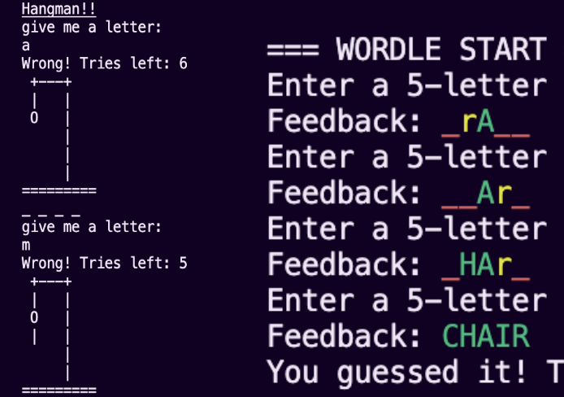
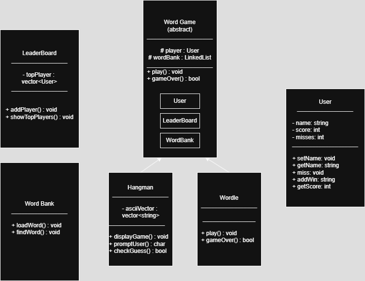
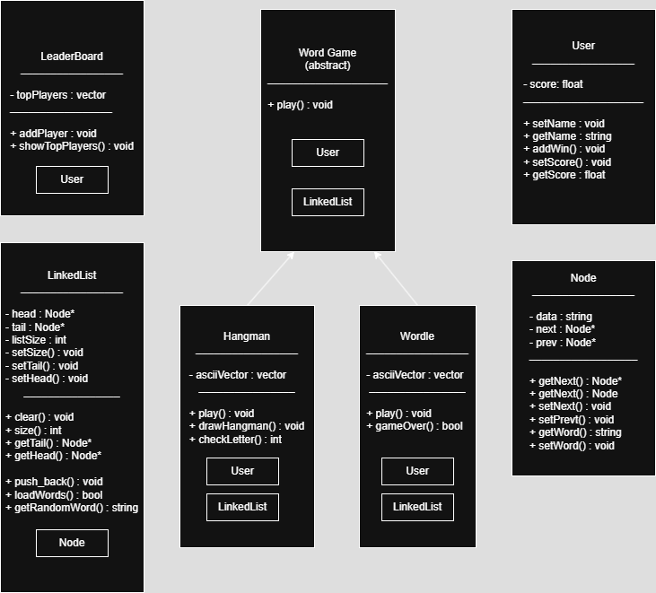

# Word Games: Hangman and Wordle in C++

A menu-driven C++ program with two classic word games, **Hangman** and **Wordle**, built on one shared object-oriented design: an abstract game class, a custom linked list for the word banks, and a leaderboard that saves the top five players to a file.

Team project for CSC 340 (Programming Methodology) at San Francisco State University, Spring 2025.



## The goal

The final project for CSC 340 was to apply object-oriented programming and core data structures in a C++ program people actually want to use, with several people editing one codebase at the same time. Word games were a good fit: they're familiar, they're fun to test, and two games could share most of the same structure.

## How to play

When the program starts, you enter your name and choose from the menu:

```
============================================
              ~~WORD GAMES~~
============================================
Options menu:
(1) Play Hangman!
(2) Play Wordle!
(3) Show the Leaderboard
(0) Exit Game
```

- **Hangman:** guess a hidden word one letter at a time. Each wrong guess adds to the ASCII-art gallows, and you have seven misses before the game ends.
- **Wordle:** guess a five-letter word in six tries. Each guess is color-coded: **green** for the right letter in the right place, **yellow** for a letter in the wrong place, and **red** for a letter that isn't in the word.
- **Leaderboard:** shows the top five players by number of wins. Each win in either game counts toward your score, and the leaderboard is saved when you exit.

## The design

We designed the classes in UML before writing code, so the whole team could work in parallel and both games could share players, scoring and word storage.

<table>
  <tr>
    <td align="center" valign="top" width="50%">
      <br>
      <sub>First draft: a separate WordBank class.</sub>
    </td>
    <td align="center" valign="top" width="50%">
      <br>
      <sub>Final design: one custom LinkedList replaces it.</sub>
    </td>
  </tr>
</table>

Between the two drafts, the word bank became our own `LinkedList` of `Node`s. That one data structure now stores both the game words and the leaderboard.

## The architecture

| Class | Responsibility |
|---|---|
| `WordGame` | Abstract base class. Holds the player and the word bank, and declares a pure virtual `play()`. |
| `Hangman`, `Wordle` | Each game inherits from `WordGame` and overrides `play()` with its own rules. |
| `User` | A player's name and win count. |
| `LinkedList`, `Node` | A custom doubly linked list. It loads the word banks from text files, picks a random word, and keeps the leaderboard sorted. |
| `GameManager` | The menu, setting up the player, and loading and saving the leaderboard. |

The key object-oriented ideas:

- **Inheritance:** `Hangman` and `Wordle` *are a* `WordGame`.
- **Polymorphism:** the menu creates either game as a `WordGame*` and calls `play()`, without knowing which one it's running. Adding a third game only means writing a new `play()`.
- **Composition:** each game *has a* `User` and a `LinkedList` word bank.

**How the leaderboard works:** it loads the saved scores from a file into the linked list. When you join, it keeps only your highest score if you've played before, inserts you in sorted order, trims the list to the top five, and writes it back to the file when you exit.

## My contribution

- **Wordle:** a random target word, input validation (letters only, exactly five), and color-coded feedback for each letter, plus a color legend shown before the first guess.
- **The leaderboard:** I built the first version, with its own list and node classes and players sorted by wins. The team then folded it into the shared `LinkedList`, which became the final top-five leaderboard.
- **The `User` class,** which tracks each player's name and wins.
- **Hangman:** `drawHangman()`, which draws the gallows for each number of misses, and the check that every guess is a letter.
- **The word banks,** expanded for both games.
- **Input validation** for the number inputs.
- **The shared VS Code build and debug setup,** so all of us could compile the project the same way. This was one of the project's hardest problems.

## Running it

You'll need a C++ compiler that supports C++11, such as `g++` or `clang++`.

```bash
g++ -std=c++11 -o WordGame main.cpp Hangman.cpp Wordle.cpp User.cpp LinkedList.cpp Node.cpp LeaderBoard.cpp GameManager.cpp
./WordGame
```

On Windows, the included VS Code task builds the project with MSYS2's `g++`.

The word banks are plain text files, `hangman_words.txt` and `wordle_words.txt`, with one word per line. Add your own words to change the games.

## Outcome

Two playable games with persistent rankings, presented to the class with a UML walkthrough and a live demo. The hardest parts weren't the games themselves. They were getting many files to compile together and agreeing on one build setup that worked on everyone's machine.

## What I learned

- **Agree on the design before the code.** A shared UML diagram let us work in parallel. Everyone knew what `play()` had to do before anyone wrote it.
- **Build tooling is part of the project.** Getting every file to compile the same way on everyone's machine took real work. I learned to treat the build setup as a shared deliverable.
- **Building a data structure shows you what you rely on.** Writing our own linked list, and sorting it ourselves, made pointers, traversal and dynamic memory concrete.
- **Small UX details matter, even in a terminal.** The color legend and the ASCII art were the parts people enjoyed most, and the parts that made the games easy to understand.

## Tech stack

C++11 · Object-oriented programming · Inheritance and polymorphism · Linked lists · File I/O · Sorting and searching · Git · VS Code

## Links

- [Project presentation](https://docs.google.com/presentation/d/19BvupAq-ijIX7F4BvwdnxrqUonZ81XD_tGm6WGJRjt4/edit?usp=sharing)
- [Case study on my portfolio](https://portfolio-emelysarcenobravo.vercel.app/work/word-games)
